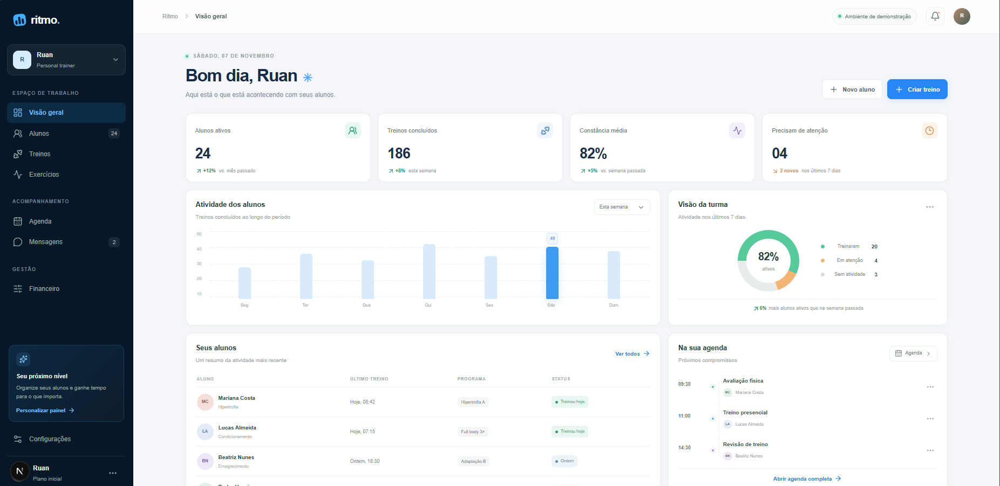
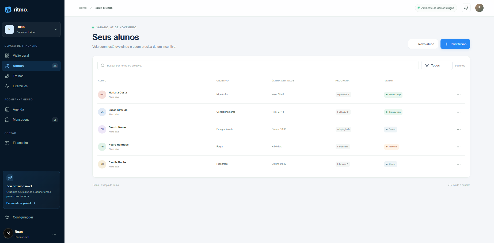
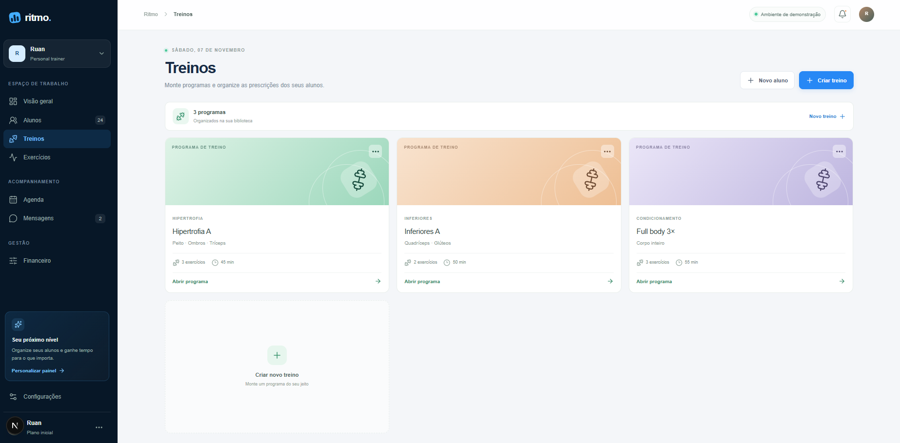
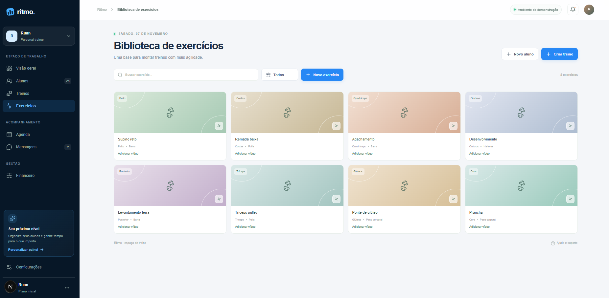
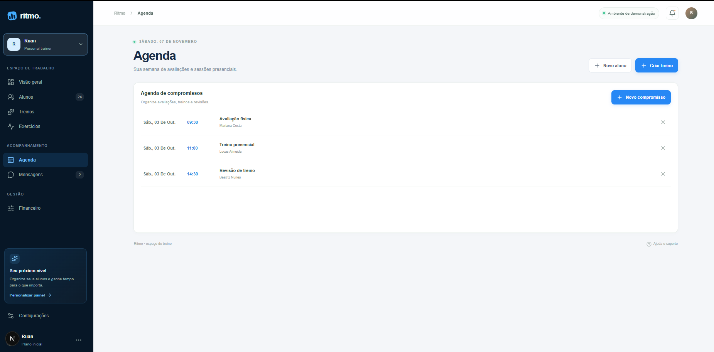
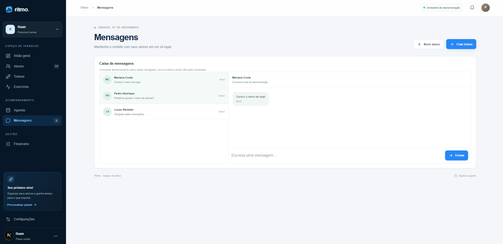
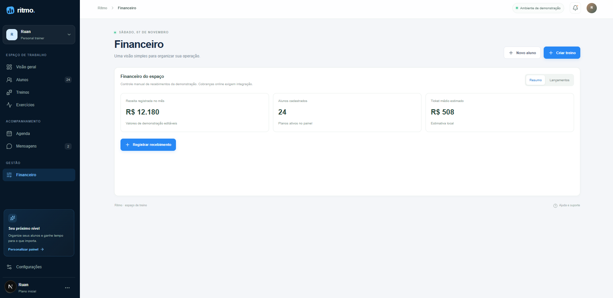

# Ritmo Personal 🏋️

**Uma plataforma para personal trainers organizarem seus alunos, treinos e acompanhamento em um só lugar.**

O Ritmo é uma aplicação web voltada à gestão de profissionais de treinamento físico. A proposta é centralizar a rotina do personal trainer em uma interface moderna, intuitiva e organizada.

> Projeto em desenvolvimento. As telas apresentadas incluem dados demonstrativos.

## 📸 Screenshots

### Visão geral
Painel com indicadores de atividade, treinos concluídos, constância dos alunos e próximos compromissos.



### Alunos
Visualização e organização dos alunos, com objetivos, programas de treino e status de atividade.



### Treinos
Biblioteca de programas de treino para organizar e prescrever exercícios.



### Biblioteca de exercícios
Catálogo de exercícios organizado por grupos musculares.



### Agenda
Organização de avaliações, sessões presenciais e revisões de treino.



### Mensagens
Interface de conversas para manter o contato com os alunos.



### Financeiro
Painel para acompanhar recebimentos e indicadores financeiros do espaço.



## ✨ Funcionalidades

- Dashboard com indicadores de acompanhamento.
- Gestão e organização de alunos.
- Cadastro e organização de programas de treino.
- Biblioteca de exercícios.
- Agenda de compromissos.
- Interface de mensagens.
- Painel financeiro.
- Interface responsiva e navegação integrada.

## 🛠️ Tecnologias

- **TypeScript**
- **React**
- **Next.js**
- **React Native**
- **Expo**
- **Supabase**

## 🎯 Objetivo do projeto

Desenvolver uma solução digital para simplificar a gestão de personal trainers, reduzindo a fragmentação de informações e facilitando o acompanhamento da rotina dos alunos.

O projeto também faz parte da minha jornada de aprendizado em engenharia de software, desenvolvimento de produtos digitais e automação de processos.

## 🚀 Executar localmente

### Pré-requisitos

- Node.js — versão definida no arquivo `.nvmrc`
- npm

### Instalação

```bash
git clone https://github.com/Ruanrobert/ritmo-personal.git
cd ritmo-personal
npm install
```

### Desenvolvimento

```bash
npm run dev
```

A aplicação web estará disponível no endereço informado pelo Next.js no terminal.

> A configuração de variáveis de ambiente pode ser necessária para recursos conectados ao Supabase.

## 👨‍💻 Desenvolvedor

**Ruan Robert de Oliveira**

Desenvolvedor de software com formação em Administração e interesse em tecnologia, desenvolvimento de produtos digitais e automação de processos.

- GitHub: [@Ruanrobert](https://github.com/Ruanrobert)
- LinkedIn: [in/ruanrobert](https://www.linkedin.com/in/ruanrobert/)

---

*Ritmo Personal — mais organização para quem transforma vidas através do treino.*